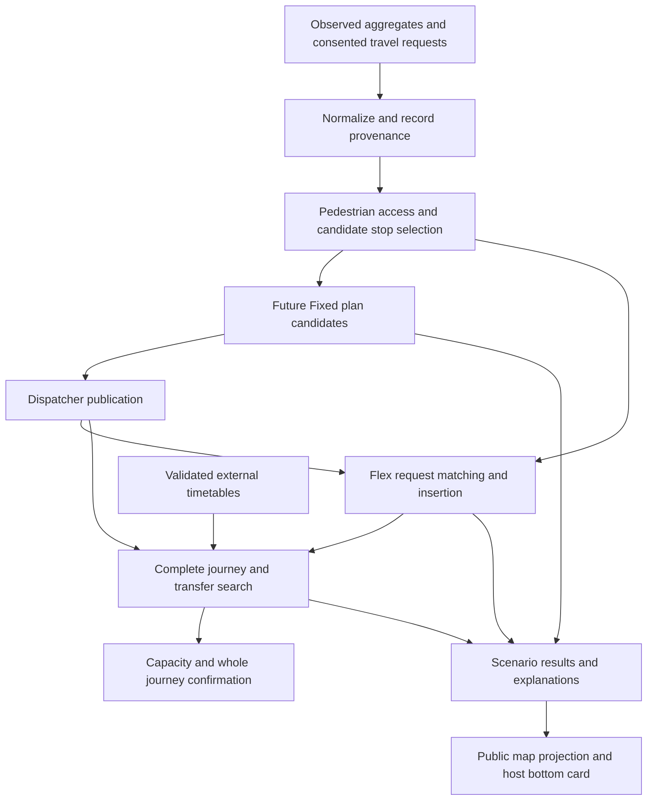

# Route planning and September pilot scenarios

Original design proposal, 15 November 2026. Subsequent implementation and its explicit limits are documented in `src/planning/README.md`.

Branch: `codex/planning-scenarios`, based on `origin/main` at `dd77c08` (including the newer dispatcher fullscreen maps).

## 1. Decisions proposed

Build a planning system with separate responsibilities for demand intake, walkable stop coverage, vehicle scheduling, journey matching and transfers. Keep these out of the map renderer. Separate strategic planning of future Fixed services from operational insertion of Flex requests between already published commitments.

Use the supplied matrix as an observed aggregate demand envelope. Construct two reproducible, explicitly simulated distributions of those same movements. Do not describe generated residents, exact dates/times, fleet resources or resulting schedules as observed facts.

Add a scenario workspace around the shared map, with a replaceable dataset and an isolated simulation clock/state. Loading a scenario must display its routes exclusively, without adding the normal seeded routes or changing existing passenger/dispatcher records.

For the first implementation, prefer a small deterministic TypeScript planning core, run in a Web Worker, over new backend infrastructure. Keep versioned input/output contracts and geographic/solver adapters so a Java backend and a stronger solver can replace it later. This is a proposed deployment choice, not an implementation already present.

## 2. Evidence checked in the repository

### Matrix and pilot geography

Source: `data a podklady/03_Podklady z dispecingu IDS Vychod/matica_SSV_8.-10.9.2026.csv`.

- Semicolon-delimited Windows-1250 text; 59 stop rows and 59 destination columns, plus totals.
- SHA-256: `a8480f965eb24adb454274b7b52acf1a7534fd590099ecd928444c1a3b79801b`.
- Pilot extraction: nine named stop groups in five villages and four in Spišská Stará Ves. There are 26 nonzero directed cells between these groups, totaling 172 movements.
- Include all four hub stop groups: AS, Tridsiatok, Vagónka and zdravotné stredisko. Restricting the hub to AS loses movements.

| Village | Village → hub | Hub → village | Total |
| --- | ---: | ---: | ---: |
| Havka | 11 | 9 | 20 |
| Zálesie | 15 | 7 | 22 |
| Jezersko | 6 | 5 | 11 |
| Lechnica | 38 | 32 | 70 |
| Veľká Lesná | 22 | 27 | 49 |
| **Total** | **92** | **80** | **172** |

Directional summaries use rows as origins and columns as destinations; confirm that convention with the data owner before operational use. The bidirectional totals reproduce the user's pilot totals exactly.

The matrix does **not** identify unique people, homes, individual travel dates, departure/arrival times, trip purposes, recurring travel, unmet demand or linked outward/return journeys. In particular, 172 movements do not imply 172 distinct people or 86 round trips. Recorded public-transport use is not evidence that every movement will transfer to our service.

Preserve observed boarding/alighting stop groups as provenance. If synthetic access points or optimized pickup stops differ, store those as separate fields rather than rewriting the observed OD cell.

### Supporting data and its limits

| Input | Useful information | Important limit |
| --- | --- | --- |
| `gtfs.zip` | Public stop coordinates, stop order, historical service definitions | Transdata version `20251106_1137`, feed/calendar validity 1. 11. 2025–9. 2. 2026; cannot establish service on 8.–10. 9. 2026; no `shapes.txt` |
| `zastavky.xlsx` | Sample platform positions at the hub | Ten data rows; not a complete six-municipality stop inventory |
| `FV_spoje_8.-10.9.2026.csv` | Period totals by line/run, passengers, kilometres and receipts | Aggregated over the period; no per-passenger dates/times and no OD-to-run assignment |
| `FV_linky_8-10.9.2026.csv` | Period totals by line | Cannot allocate a line's revenue/cost to our five villages without a valid join and allocation method |
| `vozidla_linka.xlsx` | Historical vehicle/line sample | Header is 1. 11. 2024; not our managed fleet inventory, duties or confirmed capacities |
| `garanty.xlsx` | Examples of connection rules and maximum waits | Sample with cached spreadsheet errors; no blanket guarantee for the pilot or September dates |
| Existing `demo/public-connection.json` | Independently sourced public Poprad through-service fixture | Fixture is for 16. 11. 2026; do not silently move it to September |
| Existing road caches | Computed public road geometries | Not pedestrian coverage, verified bus itineraries, operating times or stop approvals |

Zero capacity/utilization fields in frequency reports must not become evidence of zero seats or zero demand. Missing/invalid values remain unknown. Public-bus records remain external evidence, never imported as our fleet's Fixed/Flex trips.

For a factual September public transfer, obtain a timetable valid on that exact date, including calendar notes. Otherwise use an explicitly synthetic external service in the September simulation. An independently verified November demonstration can be shown separately, retaining its own date. A village→hub matrix movement cannot be relabelled as an observed journey to Košice or Poprad: add a separately identified synthetic onward-journey extension.

### Existing functionality to reuse

- `src/dispatchPlanning.ts` already checks assignments, licences, segment occupancy and timetable conflicts. It currently constructs two-stop Flex trips with a synthetic 24-minute duration, approximate repositioning and exact-endpoint/time grouping. It does not yet solve pedestrian stop coverage, general pickup/delivery insertion or transfer journeys.
- `src/search.ts` and `src/domain.ts` search existing trips and requests; they are not a complete multimodal planner.
- `src/regularPlanning.ts` manages recurring reservation processing. Preserve that lifecycle; candidate Fixed schedule generation is a different responsibility.
- `src/modules/transport-map` already accepts `MapDataset`, provides road geometry adapters and emits selections. `MapRoute.segments` can display a complete journey with multiple bus portions. `parseMapDataset` validates a map projection, not operational feasibility.
- The older `demo/MapPlayground.tsx` has JSON loading. It is a reference, not an active application-wide scenario importer.
- Passenger, driver and the newly merged dispatcher maps already reuse the renderer. Extend their adapters/hosts as needed; do not create a separate planning map engine.

## 3. Responsibilities and boundaries

Use one snapshot of canonical demand and operational state. The dispatcher submission ledger remains derived from existing requests, phone intake and recurring plans. Never build a second unsynchronized live request store. The scenario sandbox deliberately has its own isolated state, identified as simulation, rather than competing with that live/demo application state.

The planning core receives immutable inputs and returns candidates, assignments, reasons and metrics. It never modifies React state, localStorage, bookings or map selection directly. Publication/approval belongs to existing domain actions with a final feasibility recheck against the latest state revision. A stale candidate cannot approve itself.

Suggested implementation boundaries, for a later turn:

| Boundary | Owns |
| --- | --- |
| `planning/contracts` | Demand, policy, fleet/duty snapshot, versioned road/walk matrix, candidate plan, reasons |
| `planning/access` | Reachable stops and stop-set alternatives |
| `planning/fixed` | Candidate future schedules and explainable cost/service comparisons |
| `planning/flex` | Compatible pending groups, feasible insertion, vehicle/driver assignments |
| `planning/journeys` | Scheduled internal/external legs, transfers, access/egress and alternatives |
| `planning/validation` | One shared feasibility evaluator used by preview and approval adapters |
| `scenarios` | Source normalization, seeded generation, isolated replay, evaluation and imports |
| `maps` adapters | Convert authorized results into the existing public map contract |

Keep these initially as modules in the current frontend. A worker is a computation boundary, not a second source of truth. Later, an API adapter can send the same logical planning request to Spring Boot. Production booking transactions and access control remain server responsibilities.

## 4. Algorithm pipeline

### A. Discover demand, with appropriate evidence

Collect registered travel needs from the app, authorized family bookings, dispatcher/phone intake and recurring submissions. Historical OD counts and aggregate demographic/building data can guide planning. Do not infer particular residents' identities, diagnoses, home positions or willingness to travel from a matrix or map.

Separate historical observations, individual operational requests and synthetic scenario demand. Every item needs a source reference and a field-level indication of observed, derived or assumed values. Normalize municipality/stop IDs through an explicit crosswalk; matrix row numbers, GTFS stop IDs and platform IDs are not interchangeable. Ambiguous joins require review.

### B. Choose stops by pedestrian coverage and operating cost

Treat approximately eight minutes as a **configurable pilot walking budget**, initially 480 seconds for the standard simulation profile. Use actual pedestrian paths, with profile-specific walking speed, stairs/crossings/grade constraints and assistance needs. Both access to pickup and egress from dropoff matter. Do not replace this with an eight-minute circle or one distance threshold for all ages.

1. Form a bounded candidate pool from existing stops and potential safe boarding locations. Distinguish an existing external stop from permission for our fleet to use it. New locations remain proposals until reviewed; a sandbox approval is explicitly an assumption.
2. Compute directed pedestrian times between demand access points and candidates, using a versioned pedestrian network and profile. Unreachable is a distinct result. A point snapped across a river, fence or inaccessible entrance is not covered.
3. Construct the coverage relation: a stop may cover a demand point only if walk time is within that point's budget and safety/accessibility conditions pass.
4. Solve a weighted set-cover/facility-location problem. Each required demand point must be assigned to one selected eligible stop, or reported as uncovered. Candidate cost includes new-stop preparation, stopping/dwell burden and approximate route detour. Existing eligible stops generally have lower opening cost, but are not free to serve.
5. For a small candidate set, enumerate/prune subsets with branch-and-bound to certify the best stop set **for that finite model**. For a larger pool, use weighted greedy cover plus remove/swap improvement; report it as a heuristic. Keep a few nondominated stop alternatives for fleet-route evaluation.
6. Evaluate those alternatives with actual vehicle scheduling. A minimum-stop layout can require a long expensive detour; choose a layout using full operating cost, not stop count alone. Feed excessive detours or infeasibility back into the next bounded candidate iteration.

An eight-minute requirement can be infeasible. Return `NO_WALKABLE_STOP`, `STOP_REVIEW_REQUIRED` or `ACCESSIBILITY_UNMET`, with a proposed alternative or dispatcher task. Never silently lengthen a person's walk to improve profitability. We can verify coverage of supplied/simulated demand points; we cannot assert coverage of every real resident without suitable population/access data.

### C. Generate ordered routes and future Fixed schedules

Use a directed road-time matrix for vehicle profiles, not straight lines or the order in a spreadsheet. Account for one-way roads, vehicle restrictions, boarding/alighting dwell, assistance time and repositioning. Geometry through ordered stops comes from the geographic adapter after stop order is chosen; the map's geometry calculation is not the fleet optimizer.

1. Create candidate corridors from demand with compatible direction, day and time windows.
2. Identify existing external services that already satisfy some journeys, or useful feeder hubs.
3. Insert pickup/dropoff visits into candidate vehicle duties. Enforce pickup before dropoff, configured capacity on every segment, driver compatibility/duty, arrival deadlines, permitted detours and all previously committed work.
4. Start with deterministic constrained/regret insertion; improve with feasible relocate/swap and stop-order moves. Re-evaluate chronology and occupancy after every move. A simple TSP, nearest-neighbour order or k-means cluster cannot enforce these passenger constraints by itself.
5. Compare service coverage and full cost, including empty kilometres and paid driver time. Return several explainable alternatives rather than pretending a single score is a business decision.
6. A dispatcher may publish a future Fixed schedule. Once published, it remains a commitment regardless of booking count; operational Flex planning cannot move or cancel it.

Only three days of aggregate observations cannot establish a dependable recurring pattern. For this demo, the recurring profile and Fixed timetable are explicitly scenario assumptions. Production schedule design needs more evidence and dispatcher review.

For a stronger later solver, OR-Tools supports pickup/delivery, capacity and time-window building blocks. Passenger ride-time limits, accessibility, transfers, locked commitments and whole-order decisions still need explicit modelling. Time-limited vehicle routing does not establish global optimality. Preserve solver version, termination reason and any available bound; do not advertise a percentage optimality gap without one.

### D. Find a compatible existing request or ride

Use a cheap candidate index by date, direction/corridor, time-window overlap and reachable stops, followed by an actual feasibility check.

- A pending group can be combined with another pending group if their joint vehicle itinerary is feasible. This increases interest; it is not a reservation.
- A passenger joining an approved trip must fit the existing stop/timetable plan and have seats on every required segment. Do not move confirmed riders or Fixed commitments to fit them.
- A possible new detour to a confirmed service is not an automatic join; it requires a separately reviewed operation that preserves all promises.
- Check walking at both ends, pickup/dropoff order, arrival deadlines, maximum allowed onboard time/detour, vehicle accessibility, family seat count and duplicate membership.
- Return ranked feasible options, incremental cost, walk/wait times and rejection reasons. Similar-looking endpoints alone do not prove compatibility.

Keep the current passenger policy: joining remains possible within 24 hours when feasible. Withdrawal from a request and its linked reservations is blocked at or inside 24 elapsed hours before that passenger's actual boarding departure. The scenario clock must drive this consistently in every role.

### E. Insert Flex work into shared-fleet windows

For each vehicle/driver duty, derive free windows from the previous commitment's actual end location to the next commitment's start. Include the drive to the first pickup, all passenger visits, dwell, breaks and the drive back to the next Fixed departure. Freeze already confirmed promises.

For each compatible request, try all permitted pickup/dropoff insertions into eligible windows. Rank feasible insertions by incremental distance/time and passenger impact. Use deterministic ordering, a bounded improvement budget and an explicit result status. Near-deadline requests need fair prioritization; high passenger count or low cost must not be the sole rule.

The current synthetic 24-minute trip duration and straight-distance repositioning are replaceable demo approximations. Use shared road-time evaluation when this pipeline is implemented, so preview and approval cannot disagree. Protect both vehicle and driver schedules across dates, including midnight.

### F. Solve complete journeys and transfers

Model scheduled internal trips and validated external trips as dated stop events. Walking between platforms/stops is a real transfer edge, with boarding/assistance allowance and a configurable reliability margin. A feasible transfer requires:

`arrival(first leg) + transfer walk + boarding allowance + reliability margin <= departure(next leg)`

Also check acceptable waiting time, passenger access needs and service calendar. A bus-line number change does not imply a passenger transfer; the existing sourced Poprad example is a through service across two line numbers.

For the small pilot, use an event-based earliest-arrival/label-setting search with nondominated labels for arrival time, transfers and walking; support reverse search for an arrival deadline. Do not keep only the earliest label if it discards a less-walking or fewer-transfer alternative. If timetable scale later justifies it, use a RAPTOR provider behind the same journey-search boundary.

For an unscheduled Flex feeder, first find candidate public/internal departures, derive the required feeder arrival window, and ask the vehicle planner for a feasible feeder. A graph edge labelled 'Flex' is not a vehicle assignment. Bound this feedback search and return alternative hubs/times if it fails.

Managed→managed journeys require seats on both legs and coordinated assignment. Whole round trips require all internally bookable legs to succeed, with expiring provisional holds where needed. External schedules remain unreserved and unguaranteed by us; never represent public seats as held. Keep 'scheduled connection feasible' separate from 'our seats confirmed'. No passenger is silently converted to a one-way booking when the required return fails.

### G. Objectives, economics and scaling

Use hard constraints for safety, accessibility requirements, physical capacity and immutable commitments. Then apply explicit service-policy priorities and compare feasible alternatives by whole journeys served, walking/waiting, reliability and cost. Optional budget limits can leave demand unserved, but must expose that outcome and its reason. Do not allow a solver to obtain an attractive result by silently dropping difficult passengers.

Full scenario cost should include vehicle kilometres (including deadheading), driver paid time, activation/fixed fleet cost, applicable stop costs and dwell. Cost per served movement is not proof of profitability. Fare revenue, actual operator cost and any subsidy/contract payment are needed to calculate a margin; otherwise report operating metrics and a labelled cost sensitivity.

Cache matrices by ordered positions, network version, profile and relevant time context. Retain unreachable results without turning them into zero. Use spatial filtering before matrix calls. Do not send private residential data to the public OSRM demo; use a suitable configured routing provider. Valhalla's matrix supports pedestrian and vehicle costing, but data completeness still limits safety/accessibility claims.

Online insertion is bounded to relevant corridors/windows; batch planning may run longer outside the UI thread. Deterministic tie-breaking, fixed iteration budgets and pinned input matrices support replay. Record a wall-clock timeout as an additional termination condition; do not promise bitwise reproducibility from an unconstrained time-limited solver.

## 5. Two September scenarios

### Shared factual envelope and proposed daily allocation

Both scenarios retain every one of the 26 nonzero source OD cells, not just the village totals. Expand each count into anonymous movement units, retaining source row/column and unit index. These are synthetic demand units, not new passenger identities.

Proposed date split: for each OD cell in numeric `(origin row, destination column)` order, assign `floor(count/3)` units to each date, then give remaining units to the currently least-loaded date (earlier date breaks ties). Add that cell's allocation to cumulative date loads. This creates a reproducible split with exact per-cell conservation.

The following allocation was calculated from the source during this design review. Each pair is **toward hub / away from hub**. It is a simulated allocation, not an observed daily breakdown.

| Village | 8. 9. 2026, Tuesday | 9. 9. 2026, Wednesday | 10. 9. 2026, Thursday | Three-day total |
| --- | ---: | ---: | ---: | ---: |
| Havka | 4 / 4 | 3 / 3 | 4 / 2 | 20 |
| Zálesie | 5 / 2 | 5 / 3 | 5 / 2 | 22 |
| Jezersko | 2 / 1 | 2 / 2 | 2 / 2 | 11 |
| Lechnica | 12 / 10 | 13 / 11 | 13 / 11 | 70 |
| Veľká Lesná | 8 / 10 | 7 / 8 | 7 / 9 | 49 |
| **Daily total** | **31 / 27 = 58** | **30 / 27 = 57** | **31 / 26 = 57** | **172** |

Original named places remain available: Havka; both Zálesie ends; Jezersko nižný koniec and OcÚ; Lechnica; Veľká Lesná kostol, Mlyn and OcÚ; and the four hub stops. Retain platform alternatives and directional access instead of arbitrarily merging both sides of a road. Validate the crosswalk and coordinates before running road/walk computations.

For a first simulation, propose two **synthetic** vehicles with eight passenger seats each and two compatible synthetic duties. This is a controlled comparison input, not an assertion about available fleet. Store capacity per vehicle and permit sensitivity runs with different counts/capacities. Freeze the same assumed published Fixed commitments, duty/break policies and resource budget for both scenarios and all comparable strategies. Do not optimize the baseline for one strategy after seeing its results.

### Scenario A: coordinated travel

Slovak presentation name: **Zladené cesty**.

- Concentrate most hub-bound desired arrivals in 06:45–08:00, with the remainder in 09:00–11:00. Concentrate most outward desired departures in 14:00–16:30, with the remainder in 17:00–18:00. These windows are modelling choices; do not call the movements school/work/medical visits unless that purpose is separately assumed.
- Give passengers compatible flexibility within those bands. Allocate units to discrete waves using the seeded generator and segment-capacity checks rather than putting every passenger into one bus.
- Sample synthetic access points on residential pedestrian-network locations in the original stop catchments, favouring shared access. Preserve the original OD labels in provenance. Do not cluster all points exactly onto the selected stops or claim that constructed eight-minute coverage validates real residents' access.
- Use actual road travel between the derived stops; select efficient corridors only after checking the network. The coordinates alone do not justify one five-village circular route.
- Demonstrate one pending request matching a feasible group, and one additional passenger joining an assigned trip with available segment seats.
- Add a separately counted synthetic managed→managed example and a separately identified onward external example if they cannot be represented without changing the observed OD scope. Keep the 172-movement evaluation separate from these illustrative extensions.

Expected story, to be measured later: compatible windows permit grouping, reused stops and less incremental mileage. Do not claim a served percentage, number of final stops or saving before running the planner.

An immediate capacity illustration from the proposed allocation: Lechnica has 12–13 hub-bound movements per day. If all use our eight-seat vehicle on a common segment, at least two runs are needed even before walking and time constraints. Two vehicles do not imply only two runs per day.

### Scenario B: fragmented travel and peak pressure

Slovak presentation name: **Rozptýlené cesty a časový tlak**.

- Keep the same source OD cells, daily counts, fleet, published Fixed commitments and costing rules.
- Give a subset competing narrow arrival deadlines around 07:30, including demand on different road branches. Distribute other requests over 08:00–18:00 in small, less-compatible groups, with some late returns. All exact time windows are simulated.
- Put synthetic access points farther apart within the relevant settlement catchments, including access barriers or slower/step-free profiles where represented by the pedestrian network. Do not invent a real resident's disability or a factual unsafe crossing.
- Include a deterministic capacity witness: on 9. 9. 2026, the 13 Lechnica plus 7 Veľká Lesná hub-bound units can be assigned simultaneous tight windows. If they must cross a common inbound cut during a period in which each of two eight-seat vehicles can cross only once, demand is 20 seats against 16. The computed road/return times must establish that premise. The planner must offer another time/resource or report unserved demand, rather than overload a vehicle.
- Include at least one request whose feasible drive would prevent repositioning to the next immutable Fixed departure. Include a too-tight transfer and an unavailable return as explicit boundary examples, with separately declared assumptions/extensions where necessary.
- Show recovery alternatives: wider time window, a reviewed new stop, another eligible hub, or additional fleet. Report the resulting cost/service tradeoff without silently relaxing a person's walking or safety requirement.

Expected story: extra stops and dispersed trips can increase deadheading, waiting and cost; some journeys may be infeasible. These are scenario hypotheses, not calculated outcomes. Call this a stress case, not a mathematical worst case or evidence of how residents actually behave.

### Return journeys and scenario fairness

Do not automatically pair inward and outward counts. For a whole-round-trip demonstration, create an explicit synthetic linkage between compatible units without changing cell totals, record the assumption, and count completed whole orders separately. Any unmatched units remain one-way. An extra out-of-area destination is an extension, not part of the source matrix.

Within each scenario compare the same demand and resources under:

1. Published Fixed only.
2. The same Fixed commitments plus feasible Flex insertion.
3. The same hybrid system plus external transfer options valid for the simulated date, or explicitly synthetic external options.

Use the same event ordering, clock, demand seed and policy in each comparison. If no valid public timetable is available, the third comparison demonstrates a synthetic mechanism, not a measured improvement from real September public services. Compare both scenarios, and later several seeds, to avoid presenting a deliberately favourable sample as proof of general performance.

## 6. Scenario format and exclusive map import

### Two distinct contracts

**Scenario input** is the immutable experiment specification: schema version; ID/name; Bratislava timezone; dates and initial virtual instant; seed/generator version; source hashes; stop crosswalk; observed OD counts; synthetic access/time assumptions; fleet/duties; eligible/candidate stop statuses; frozen Fixed commitments; external calendar references; policy and cost parameters; network/matrix version.

**Scenario result** is produced by a particular planner/version/strategy: source input hash; run ID; termination status; selected stops; explicit unserved units/reasons; ordered vehicle trips and visit occurrences; vehicle/driver assignments; chronological stop events; movement→trip-segment assignments; complete passenger journeys and transfer edges; reservation outcomes; road geometry references; auditable metrics and decisions.

A candidate stop set or hand-authored route file is not a successful optimization run. A saved result must identify whether it was computed, authored or imported and must pass independent feasibility validation. Computed KPI values must be recomputed from events/assignments rather than trusted from uploaded summary text.

Use versioned JSON first. CSV belongs at the ingestion boundary; generic GPX/GeoJSON carries geometry but not capacities, calendars, order semantics or booking guarantees. Never use `MapDataset` as the entire domain schema. The existing parser can validate the final public projection after domain validation.

### Loading behaviour

1. Choose a built-in scenario or upload a scenario input/result file. Apply file size/record/geometry limits, version checks, finite coordinates, unique IDs and referential validation. No arbitrary code, remote fetch instruction or unreviewed URL from a file is executed.
2. Validate source scope, integer OD totals, real calendar dates, timezone, chronological events, per-vehicle duties, segment seats, geometry coverage, transfer feasibility and whole-order status. Surface errors by record/path. Unknown is different from zero.
3. Preview the scenario's provenance, assumptions, dates, counts and warnings. A scenario input can then be computed; a result can be inspected without rerunning if its matrices and validation are available.
4. Replace the active scenario atomically. Use IDs namespaced by scenario/run/strategy. Reset route/stop selection and set date/time filters to that scenario. Cancel or ignore stale asynchronous routing/planning responses from the previous scenario.
5. The bottom card lists **only the active result's vehicle runs**, filtered by its date/time/type. Label whether a run is a candidate or simulated published/approved trip. Show unserved demand in a separate result view; it must not masquerade as a confirmed route.
6. One whole-card tap selects a run, draws its one road route and opens stop/assignment information. Back restores the list and its filters. No automatic first route selection.
7. A complete-journey detail can instead select one journey whose several bus legs are drawn together, with bright per-leg colours, solid managed portions and dashed external portions. The host makes clear that this is a passenger journey, not one vehicle run. Do not mix these two list meanings silently.
8. Exiting returns to normal application data without modifying or appending to it. Existing bookings, dispatcher records and household data remain untouched. Publishing a plan into the normal system, if added later, is a distinct reviewed operation with feasibility checks, not a side effect of import.

The map receives only an allowlisted public projection: approved/demo public stop positions, route geometry, times and aggregate counts. Private access points, identities, contacts, individual assistance and booking records remain outside it. Detailed simulation access points may be inspected in an explicitly synthetic analysis view, never reused as real public household markers.

Planning, file validation and dataset replacement belong in the scenario host. `TransportMap` retains camera/tiles, route/stop selection, point selection, geometry rendering and its `renderCard` boundary. Reuse the existing active fullscreen shell and role adapters. The map must not fetch the normal seeded dataset behind the host's back.

## 7. Measures and presentation sequence

Report demand reconciliation (172 source movements; 58/57/57 by assumed date), complete journeys served, unserved reasons, standard/profile-specific walk-time distribution, waiting/onboard time, selected/new stop count, operated runs, peak segment load, passenger-kilometres, available seat-kilometres, total/deadhead kilometres and driver/vehicle time. Mean occupancy must be weighted by distance, not an average of run percentages. Separate whole round-trip success from one-way movement success.

Always show zero planned overcapacity and zero planned violations of frozen Fixed commitments for a feasible published plan. Late/missed connections and uncovered demand must stay visible. Cost per movement/journey and financial margin need explicitly configured inputs and matching denominators. An external segment adds passenger travel but does not add kilometres to our fleet.

Proposed presentation sequence:

1. Show the factual 172-movement table and six places, explaining the simulated detail added to it.
2. Load Zladené cesty. Show the selected stops, their simulated pedestrian coverage, generated runs and why compatible requests share a vehicle.
3. Select one journey, inspect its ordered stops and illustrate a managed/managed or managed/external transfer with its provenance visible.
4. Switch to Rozptýlené cesty a časový tlak. Show a capacity/time/reposition failure, the preserved Fixed departure and an unconfirmed return. Explain the best available alternative.
5. Compare the three strategies on the same scenario inputs. Show measured service/cost tradeoffs after implementation, without invented percentage savings.

## 8. Implementation order and acceptance criteria

This document is the architecture deliverable. No new planner, importer, scenario route data or UI is implemented in this turn.

Recommended implementation order:

1. Normalize/reconcile the matrix and stop crosswalk; define provenance and scenario input contracts. Resolve September external timetable availability or explicitly choose synthetic external legs.
2. Prepare a bounded versioned road/pedestrian matrix and reviewed/sandbox-labelled candidate pool. Implement coverage and independent feasibility evaluation first.
3. Implement strategic candidates and online matching/insertion against the same evaluator. Preserve the current domain's approvals, recurring bookings and passenger rules.
4. Implement dated complete journeys and coordinated internal booking semantics. Add a stronger solver only if the initial heuristics cannot meet measured pilot requirements.
5. Generate the two scenarios, replay the strategy comparisons, then expose result import/replacement through the existing fullscreen map host.
6. Add presentation views and actual comparison figures only after the results pass the following checks.

Acceptance checks for that later implementation:

- All 26 observed directed OD cells reconcile, with no totals row treated as demand, no duplicate trips and no passenger identity inferred. Daily sum is 58/57/57 for this allocation.
- Eight-minute walking boundary is tested at 480/481 seconds with the same profile/network; barriers, asymmetric paths and unreachable results do not pass coverage.
- A proposed/externally mapped stop is never silently approved for managed use. Matrix stop groups and platforms stay traceable.
- Segment capacity checks include held/confirmed seats and families; seats can be reused after alighting. Two individually feasible insertions cannot both consume the last seat.
- Confirmed timetable and pickup/dropoff promises remain fixed. A feasible passenger drive with an infeasible reposition fails. Duty breaks and dates/midnight are checked.
- Exact 24-hour withdrawal boundary, permitted late joining and virtual-clock consistency are retained.
- Managed/managed transfers secure all internal legs; failed return or expired hold releases the linked hold. External legs never acquire a fake seat guarantee.
- Calendar-inactive and out-of-validity external services fail; service-day times after midnight are normalized to dated instants and Slovak display.
- Matching checks actual vehicle feasibility after spatial/time prefiltering. Outcomes distinguish proven infeasible, no feasible plan found within budget and missing data.
- Import cannot append default routes, mutate existing data, leak private fields, retain a stale selected route or allow a previous asynchronous result to reappear.
- Route lists start unselected, whole cards work with keyboard/touch, back preserves filters, and exactly one selected route/journey is rendered.
- Metrics independently reconcile to movement assignments and vehicle events. Both scenarios use the same declared resource constraints and each strategy sees identical demand/event ordering within its scenario.
- Replaying pinned inputs/seed/algorithm configuration produces the same deterministic result, with deviations or timeout/solver versions disclosed.

## 9. Technical references

Primary references checked for this design:

- [Valhalla matrix API](https://valhalla.github.io/valhalla/api/matrix/): pedestrian and vehicle time/distance matrices; geographic engine adapter, not fleet optimization.
- [OR-Tools pickup and delivery](https://developers.google.com/optimization/routing/pickup_delivery) and [vehicle routing with time windows](https://developers.google.com/optimization/routing/vrptw): building blocks for a later route-solver adapter.
- [OR-Tools routing options](https://developers.google.com/optimization/routing/routing_options): bounded search and termination status.
- [Round-Based Public Transit Routing, Delling/Pajor/Werneck](https://www.microsoft.com/en-us/research/publication/round-based-public-transit-routing/): scalable timetable search with arrival-time/transfer alternatives; not a dynamic fleet dispatcher.
- [GTFS Schedule reference](https://gtfs.org/documentation/schedule/reference/): calendars, stop events, platform/transfer semantics and service-day time handling.

Original supplied data and workbooks were inspected read-only. No demand file, timetable, source workbook or application code was modified for this design.
